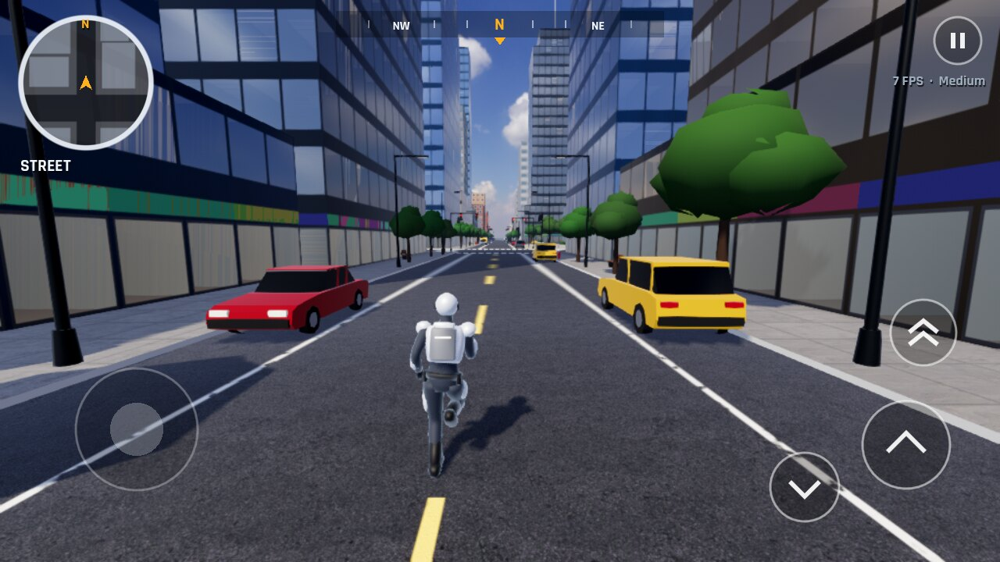
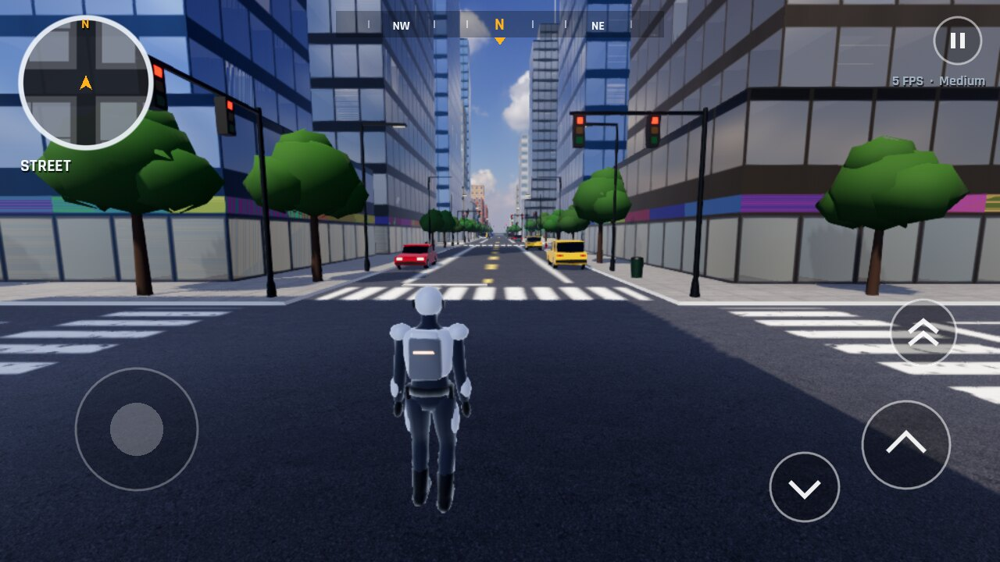
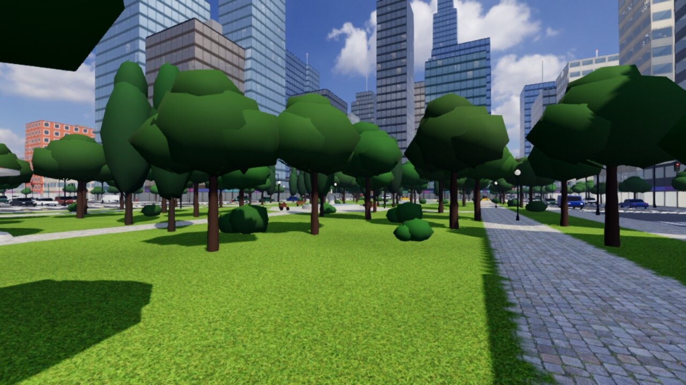
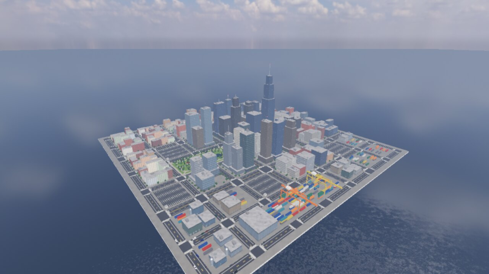
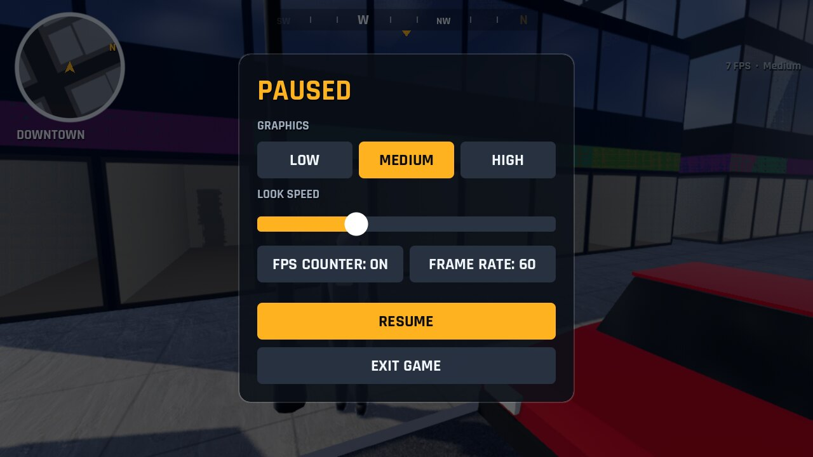

# Battle World

A third-person **battle royale** game for Android, set in a modern city.
You play offline against computer fighters. It is built with the
[Godot engine](https://godotengine.org) (version 4.7.2) and its language GDScript, which looks a lot like Python.

The game is being built **part by part**. This folder holds **Part 1: the foundation**.



| | |
|---|---|
|  |  |
|  |  |

## What Part 1 has

- **A city to fight in**: 46 blocks on an island about 530 m wide. Downtown glass towers, shops,
  brick homes, a park, a car park, factories, a harbour with containers and cranes, and one very tall
  landmark tower you can see from everywhere. About 230 buildings, 640 parked cars and 630 trees.
- **A hero** you see from behind: walk, run, sprint, jump and crouch. The body and all its movement
  are made by code (no animation files).
- **Touch controls**: move stick on the left, drag on the right to look, buttons for jump, crouch and sprint.
- **A camera** that follows over the shoulder and moves in when a wall is in the way.
- **HUD**: round minimap, compass, the name of the place you are in, and an FPS counter.
- **Pause menu** with settings: graphics Low / Medium / High, look speed, 30 or 60 frames per second.

There is **no fighting yet**. Weapons and enemy fighters come in Part 2.

## The plan

| Part | What | Status |
|---|---|---|
| 1 | Foundation: city, hero, camera, touch controls, HUD, Android build | Done |
| 2 | Combat: weapons, shooting, health, enemy fighters | Next |
| 3 | Battle royale rules: drop in, loot, shrinking safe zone, last one alive wins | |
| 4 | Bigger world: more districts, vehicles to drive, smarter enemies | |
| 5 | Polish: better graphics and effects, sound and music, main menu, progress | |
| 6 | Speed tuning for phones and a release build | |

## Play it on an Android phone

You need an Android phone with a 64-bit system (almost every phone from the last 6 years), Android 7 or newer.

1. Copy the file `BattleWorld-0.1.0-debug.apk` to the phone.
2. Tap the file. Android asks if you allow installing from this source: allow it.
3. Open **Battle World**.

If the game runs slowly, tap the pause button (top right) and pick **LOW** graphics, or set the frame rate to 30.

The APK file is not stored on GitHub (it is 47 MB). Build it yourself with the steps below.

### Controls on a phone

| Do this | To |
|---|---|
| Put a thumb on the left side and slide | Move. A small push walks, a full push runs |
| Slide the stick far up | Sprint |
| Drag on the right side | Look around |
| Button with one arrow up | Jump |
| Button with one arrow down | Crouch (tap again to stand up) |
| Button with two arrows | Sprint on / off |
| Pause button, or the phone's Back button | Pause and settings |

### Controls on a PC (for testing)

`W A S D` move, mouse looks, `Shift` sprint, `Space` jump, `C` crouch, `Esc` pause. A gamepad works too.

## Open it on a PC

1. Download **Godot 4.7.2** (the standard version) from <https://godotengine.org/download>.
2. Start Godot, choose **Import**, and pick the file `project.godot` in this folder.
3. Press **F5** to play.

## Build the Android app yourself

1. In Godot, open **Editor → Manage Export Templates** and install the templates.
2. Install the Android SDK and Java, then set both folders in
   **Editor → Editor Settings → Export → Android**.
   The official guide: <https://docs.godotengine.org/en/stable/tutorials/export/exporting_for_android.html>
3. Run:

   ```bash
   tools/build_apk.sh
   ```

   The app appears in `build/BattleWorld-0.1.0-debug.apk`.

The app is signed with the test key in `android/debug.keystore` (password `android`). This key is not a
secret. It only exists so that a new test build can be installed over the old one. A Play Store release
needs your own private key.

## Tests

```bash
tools/test.sh
```

This runs three sets of checks without a screen:

- **City data** (15 checks): the same seed always builds the same city, no buildings overlap,
  no lamp or tree stands inside a building, every start place is free.
- **The game plays itself with the keyboard** (20 checks): run, sprint, jump height, stepping up a kerb,
  being stopped by a wall, turning the camera, crouching, pausing.
- **The same with touch controls** (24 checks): the move stick, look dragging and the jump button,
  with several fingers at once.

To also save pictures while the game plays itself (this needs `xvfb` and a software Vulkan driver on Linux):

```bash
SHOT_DIR=/tmp/shots tools/render.sh vk res://scenes/main.tscn --autotest --touch
```

**Not tested yet:** the game has only been run on a computer with software rendering. It has not been
run on a real phone, so real speed and feel on a phone are still unknown.

## Folders

| Folder | What is inside |
|---|---|
| `scenes/` | `main.tscn`, the scene the game starts with |
| `scripts/core/` | `game.gd` starts everything. `controls.gd` and `settings.gd` are always loaded |
| `scripts/world/` | The city: `city_layout.gd` plans it as data, `city_builder.gd` makes the 3D shapes, `prop_library.gd` makes lamps, trees and cars |
| `scripts/player/` | The hero: movement, camera, the body (`character_rig.gd`) and its animation (`character_animator.gd`) |
| `scripts/ui/` | HUD, touch controls and pause menu |
| `scripts/util/` | `mesh_builder.gd`, a helper for making 3D shapes from code |
| `shaders/` | Small GPU programs: building fronts with windows, roads with painted lines, sky, water |
| `assets/` | Pictures for the ground, the sky photo, the font and the app icon |
| `tests/` | The automatic checks |
| `tools/` | Scripts to build the app, run tests, take pictures and remake the icon |

## How some things work

- **Buildings are plain boxes.** The shader `shaders/building.gdshader` paints windows, frames and shop
  fronts on them. It even draws fake rooms behind the glass (a trick called *interior mapping*).
- **Road paint is maths.** `shaders/road.gdshader` works out lane lines and zebra crossings from the
  street grid numbers, so they stay sharp at any distance.
- **The hero's walk has no animation files.** `character_animator.gd` works out where each foot should
  be for every moment of a step, then bends hip and knee so the foot reaches that place (*two-bone IK*).
- **One file per job.** For example, the hero only reads simple values from `controls.gd`, so it does not
  care if you use a keyboard, a gamepad or a touch screen.

## Credits

Free assets made by other people are listed with their licences in [CREDITS.md](CREDITS.md).
